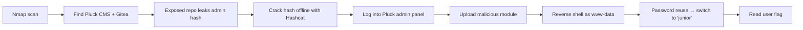
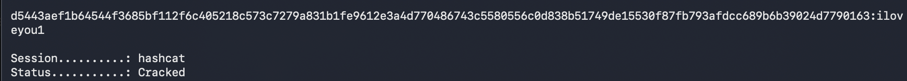

# Hack The Box: GreenHorn Write-up

A walkthrough of the **GreenHorn** machine on Hack The Box, a retired Linux box rated *Easy*. The path to the user flag chained an exposed source-code repository, offline password cracking, a file-upload flaw, and a case of password reuse.

**Tools used:** Nmap, Gitea (web), Hashcat, Netcat, Linux CLI

> This is a documented, intentionally vulnerable practice machine on Hack The Box. All work was done in HTB's isolated lab environment.

## Summary of the attack path

## 1. Enumeration

I started with an Nmap scan of the target, which showed three open TCP ports: SSH (22), HTTP (80), and a service on 3000.

I added the target to my `/etc/hosts` file as `greenhorn.htb` so the web app would load correctly, then viewed the site's page source. It revealed the site was running **Pluck CMS version 4.7.18**.

**Lesson:** always enumerate *every* open port. The web server was the obvious target, but the service on port 3000 turned out to be the real way in.

## 2. Finding the admin hash

Pluck's admin panel needs a password, so rather than attacking the login page directly, I looked at the service on port 3000, which was a **Gitea** instance (a self-hosted code platform). Since Gitea hosts source code, I checked it for exposed repositories and found a **public repo containing the application's full source code**.

Pluck stores its admin password as a hash in a configuration file (`data/settings/pass.php`). Because the repo was public, that hash was sitting right there for anyone to read.

**Lesson:** secrets like password hashes should never be committed to a repository, especially a public one. This is a very common real-world mistake.

## 3. Cracking the hash

I copied the hash out of the exposed config file and first confirmed its type. `hashid` identified it as **SHA-512**.

I then cracked it offline with **Hashcat** (hash mode 1700, for SHA-512) using the well-known `rockyou.txt` wordlist. The hash matched a word in the list, recovering the plaintext admin password.

**Lesson:** offline cracking is fast and silent. Once an attacker has a hash, a weak or common password offers almost no protection, which is why strong, unique passwords matter.

## 4. Admin access to a foothold

I logged into the Pluck admin dashboard with the cracked password.

From there, I used the **"Install modules"** feature, which lets an admin upload a module as a ZIP file.

The flaw: this version of Pluck extracts an uploaded ZIP into the website folder **without checking its contents**. By packaging a PHP file into a ZIP, I could get my own code placed somewhere it would run on the server.

**Lesson:** file-upload features must validate what's being uploaded. Blindly extracting an archive into a web-accessible folder lets an attacker run their own code.

> Note: I've left the actual payload file out of this public write-up on purpose. The goal here is to document the *vulnerability and method*, not to hand out a ready-to-run exploit.

## 5. From web user to real user

I started a **Netcat** listener and triggered the uploaded file, which caught a connection back from the target. Running `whoami` returned **www-data**, the low-privilege account the web server runs as. That account couldn't read the user flag.

Looking around, I found a real system account called `junior`, but www-data couldn't read its home folder. I suspected the admin had **reused their Pluck password** elsewhere. Using `su junior` with the same password I'd already cracked, I switched into that account, moved into its home folder, and read **user.txt**.

**Lesson:** password reuse is one of the most common ways attackers escalate access. The same cracked password worked in two completely different places.

## Key takeaways

| Weakness | How it was exploited | Real-world fix |
|---|---|---|
| Exposed source code | Public Gitea repo leaked the admin hash | Keep repos private; never commit secrets |
| Weak password | Cracked a SHA-512 hash with a wordlist | Enforce strong, unique passwords |
| Unvalidated file upload | Uploaded a module that ran as code | Validate and sandbox uploads |
| Password reuse | Same password unlocked a second account | Use a unique password per account |

## What I learned

- How thorough port enumeration opens up paths the obvious target doesn't
- How exposed repositories leak credentials in the real world
- How offline hash cracking works with Hashcat and wordlists
- How a single file-upload flaw leads to code execution
- Why password reuse turns one weakness into several

*Completed as part of penetration testing coursework at USF.*
